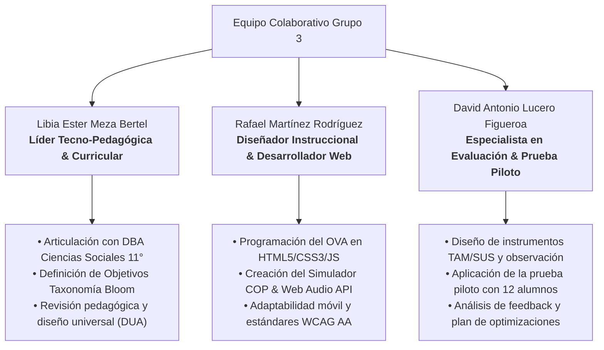
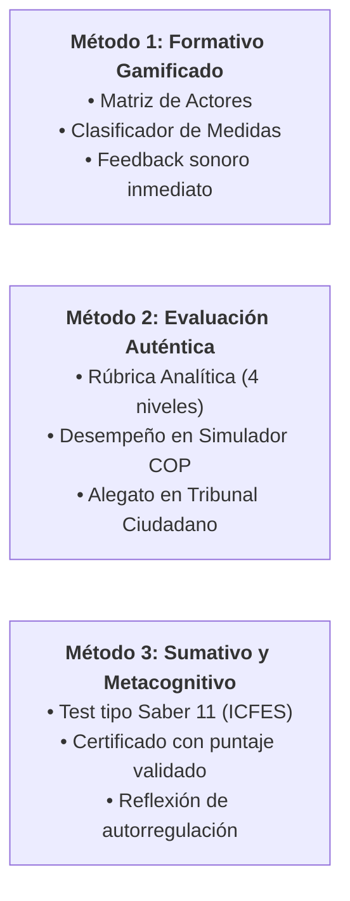

# UNIVERSIDAD TECNOLÓGICA DE BOLÍVAR (UTB)
## Maestría en Educación Mediada por las TIC
### Módulo: Integración de las TIC en educación

---

# INFORME FINAL Y MEMORIA TÉCNICA DEL PROYECTO INTEGRADO
## *"Clima, Poder y Futuro: Decisiones Globales, Responsabilidades y Transición Energética"*

> **Resultado de Aprendizaje Evaluado:**  
> *"Diseño y aplico recursos de aprendizaje aprovechando las herramientas digitales, para promover la participación activa y el logro de objetivos de aprendizaje de los estudiantes."*

| Datos del Proyecto | Detalle Institucional y Curricular |
| :--- | :--- |
| **Grupo de Trabajo** | **Grupo 3** |
| **Autores Docentes** | **Libia Ester Meza Bertel** **Rafael Martínez Rodríguez** **David Antonio Lucero Figueroa** |
| **Asesoría Pedagógica** | Mg. Liliana Castaño Lotero / Dr. Gabriel Román Meléndez |
| **Institución Educativa de Aplicación** | Institución Educativa Ciudad de Ipiales (INEDCI) — Ipiales, Nariño, Colombia |
| **Área y Nivel** | Ciencias Sociales y Competencias Ciudadanas • Grado Undécimo (11.°) |
| **Tiempo de Dedicación** | HAD: 6 horas (Acompañamiento Docente) \| HTI: 18 horas (Trabajo Independiente) |
| **Modalidad** | Colaborativa • Proyecto Integrado Tecno-Pedagógico |
| **Enlace del OVA en Vivo** | [https://libiasa56-ctrl.github.io/ova-cambio-climatico/](https://libiasa56-ctrl.github.io/ova-cambio-climatico/) |
| **Enlace de la Presentación Interactiva** | [https://libiasa56-ctrl.github.io/ova-cambio-climatico/presentacion.html](https://libiasa56-ctrl.github.io/ova-cambio-climatico/presentacion.html) |
| **Repositorio GitHub** | [https://github.com/libiasa56-ctrl/ova-cambio-climatico](https://github.com/libiasa56-ctrl/ova-cambio-climatico) |

---

## 1. PASO 1: CONFORMACIÓN DEL GRUPO DE TRABAJO, ROLES Y METODOLOGÍA COLABORATIVA

Para el desarrollo del proyecto integrado, los integrantes del **Grupo 3** nos articulamos bajo una metodología de trabajo colaborativo basada en complementariedad de perfiles, responsabilidad compartida y toma de decisiones por consenso (Doblas, Anillos de la Torre & Lisbona, 2022). Se estableció una matriz de asignación de responsabilidades tipo RACI (*Responsible, Accountable, Consulted, Informed*):

### Matriz de Roles y Responsabilidades (Grupo 3)

### Herramientas de Gestión y Trabajo Colaborativo Empleadas:
1. **Google Drive & Documentos Compartidos:** Plataforma central asincrónica para la co-redacción del guion pedagógico, bitácoras de trabajo y compilación bibliográfica.
2. **Microsoft Teams / Google Meet:** Espacio para 4 encuentros sincrónicos de planificación, diseño conceptual y validación de avances pedagógicos.
3. **GitHub & Netlify:** Sistema de control de versiones y canal de integración continua (*CI/CD*) que permitió el versionado colaborativo del código del OVA y el despliegue automático en la nube.

---

## 2. PASO 2: REVISIÓN Y SELECCIÓN DE CONTENIDOS DIGITALES Y HERRAMIENTAS TECNOLÓGICAS (Criterio 1: 1.25 / 1.25 pts)

En concordancia con los lineamientos de la Universidad Tecnológica de Bolívar (UTB, 2024) para la caracterización y evaluación de herramientas digitales (criterios de usabilidad, pertinencia curricular, accesibilidad, interactividad y valor formativo añadido), se seleccionó un ecosistema de **6 contenidos digitales y herramientas tecnológicas** altamente compatibles entre sí, superando el umbral superior de la rúbrica (5 o más herramientas):

| N.° | Herramienta / Contenido Digital | Tipología & Licencia | Función Pedagógica en el Escenario | Compatibilidad & Complementariedad Técnica |
| :---: | :--- | :--- | :--- | :--- |
| **1** | **Objeto Virtual de Aprendizaje (OVA) Interactivo Web** | Recurso Abierto (OER) • HTML5 / CSS3 / ES6 nativo | Plataforma nodal que estructura el aprendizaje en 15 módulos interactivos, gamificación con puntaje y narración. | Arquitectura 100% autocontenida que se ejecuta en cualquier navegador sin servidor; aloja e integra armónicamente todos los recursos. |
| **2** | **Simulador Interactivo Multilateral de Negociación COP** | Simulación Computacional Basada en Modelos Heurísticos | Aprendizaje experiencial y toma de decisiones: calcula en tiempo real el aumento térmico (°C) vs. el índice de equidad social (%). | Embebido nativamente en la página 11 del OVA mediante JavaScript; transfiere variables de desempeño al certificado final. |
| **3** | **Laboratorio de Fact-Checking & Test Saber 11** | Motor Evaluativo Interactivo en Línea | Desarrollo del pensamiento crítico mediante el análisis de 3 expedientes reales de noticias/greenwashing y preguntas tipo ICFES. | Retroalimentación instantánea sin recarga de página; compatible con pantallas táctiles, teclados y lectores de pantalla. |
| **4** | **Motor de Síntesis de Voz (Web Speech API - TTS)** | Tecnología Asistiva de Inclusión DUA | Lectura auditiva sincronizada de textos para estudiantes con diversos estilos de aprendizaje o dificultades visuales (Abarca et al., 2023). | Integrado en el DOM nativo del navegador; no consume ancho de banda adicional y funciona en modo offline. |
| **5** | **Google Workspace & Formularios de Evaluación TAM/SUS** | Suite Colaborativa en la Nube | Co-construcción de alegatos en el "Tribunal Ciudadano" y recolección cuantitativa de percepción de usabilidad y utilidad tecnológica. | Enlace bidireccional desde el OVA; exportación inmediata de datos tabulados a hojas de cálculo para su tratamiento estadístico. |
| **6** | **Repositorios Abiertos de Datos Climáticos (Climate Watch / IPCC)** | Contenidos Digitales Abiertos Curados (OER) | Visualización científica de series históricas de emisiones acumuladas frente a compromisos corporativos. | Formatos vectoriales SVG y gráficos ligeros integrados dentro de las infografías del OVA sin sobrecargar la red escolar. |

> **Justificación de Complementariedad:** Las herramientas no operan de forma aislada, sino como un engranaje pedagógico coherente: el *OVA* provee la estructura; la *Síntesis de Voz* garantiza la accesibilidad universal; el *Simulador COP* y el *Lab de Fact-Checking* transforman el conocimiento pasivo en experiencia viva y analítica; los *Datos del IPCC* proporcionan rigor científico empírico; y *Google Workspace* canaliza la deliberación comunitaria y la evaluación del proceso.

---

## 3. PASO 3: PLANIFICACIÓN DIDÁCTICA EN EL ESCENARIO EDUCATIVO (Criterio 2: 1.25 / 1.25 pts)

### 3.1. Contexto del Escenario Educativo
- **Institución:** Institución Educativa Ciudad de Ipiales (INEDCI), Nariño.
- **Población Objetivo:** 36 estudiantes del grado Undécimo (11-2), jornada de la mañana.
- **Características:** Zona de frontera andina colombo-ecuatoriana. Estudiantes con alta sensibilidad hacia la protección de los páramos y cuencas hidrográficas de Nariño, pero con acceso asimétrico a conectividad de alta velocidad en sus hogares. Esta particularidad exigió que el proyecto fuera concebido bajo una filosofía *offline-first* y de bajo consumo de datos.
- **Alineación Curricular:** Derechos Básicos de Aprendizaje (DBA) de Ciencias Sociales para Grado 11.° (Tercer Periodo Académico, Malla Curricular 2026):
  > *"Analizar críticamente la relación entre las decisiones económicas, políticas y sociales de los diferentes actores involucrados en el cambio climático y sus efectos sobre el bienestar y la supervivencia de la humanidad, mediante el uso de herramientas digitales que permitan investigar, interpretar información, contrastar perspectivas, argumentar y proponer alternativas de transición energética sostenible."*

### 3.2. Objetivos de Aprendizaje Claros y Medibles (Taxonomía de Bloom/Marzano)

Se formularon **3 objetivos de aprendizaje específicos, claros y medibles**:

1. **Objetivo 1 (Nivel Bloom: Analizar / Diferenciar):**  
   *Examinar críticamente la relación entre las decisiones geopolíticas y corporativas de los actores globales y las emisiones acumuladas de GEI, contrastando datos empíricos frente a discursos de greenwashing publicitario con al menos un 80% de asertividad en el Laboratorio de Fact-Checking.*
2. **Objetivo 2 (Nivel Bloom: Evaluar / Tomar Decisiones):**  
   *Simular acuerdos multilaterales en el simulador COP mediante la ponderación de políticas energéticas, logrando mantener el aumento de temperatura proyectado por debajo de 1.5 °C e integrando un índice de justicia y equidad social superior al 70%.*
3. **Objetivo 3 (Nivel Bloom: Crear / Proponer):**  
   *Formular y sustentar colaborativamente un alegato fundamentado de transición energética justa y comunitaria en el Tribunal Ciudadano, articulando al menos 3 evidencias fácticas y contraargumentando falacias discursivas de actores hegemónicos.*

### 3.3. Tres Métodos de Evaluación Adecuados

Para garantizar una evaluación integral (diagnóstica, formativa y sumativa/auténtica), se definieron **3 métodos de evaluación articulados**:

1. **Método 1: Evaluación Formativa Gamificada en Tiempo Real:**
   - *Instrumentos:* Actividades de emparejamiento interactivo, matrices de clasificación de medidas (mitigación vs. adaptación vs. falsas soluciones) y juego de memoria de economía ecológica.
   - *Mecanismo:* Retroalimentación inmediata sonora (Web Audio API) y textual. El error se concibe como oportunidad de aprendizaje: si el estudiante falla, el recurso emite una pista orientadora y permite reintentar sin penalización punitiva.
2. **Método 2: Evaluación Auténtica mediante Rúbrica Analítica de Desempeño:**
   - *Instrumentos:* Matriz de valoración analítica con 4 niveles de logro (*Superior, Alto, Básico, Bajo*) que evalúa las producciones del *Simulador COP* y el alegato redactado en el *Tribunal Ciudadano*.
   - *Criterios valorados:* (a) Dominio conceptual y causalidad climática; (b) Rigor en el uso de fuentes y detección de falacias; (c) Perspectiva de justicia y derechos humanos; (d) Capacidad propositiva y viabilidad territorial.
3. **Método 3: Evaluación Sumativa Objetiva Tipo Saber 11 y Validación Metacognitiva:**
   - *Instrumentos:* Banco de 4 preguntas complejas de selección múltiple con única respuesta diseñadas bajo la metodología de diseño centrado en evidencias del ICFES (competencias ciudadanas y ciencias sociales), articulado con la generación del *Pasaporte Climático Oficial*.
   - *Mecanismo:* Cálculo automático del puntaje global acumulado (hasta 240 puntos de aprendizaje) reflejado en el diploma imprimible firmado por el comité docente.

### 3.4. Planificación Didáctica: Secuencia en 4 Fases (HAD: 6h / HTI: 18h)
- **Fase 1: Enganche y Diagnóstico (HAD: 1.5h | HTI: 3h):** Presentación del dilema territorial, exploración de la portada y contextualización curricular. Activación de presaberes mediante la Matriz de Actores.
- **Fase 2: Laboratorio Crítico y Fact-Checking (HAD: 1.5h | HTI: 5h):** Análisis de emisiones históricas en el Eje 1 con apoyo de voz TTS. Expedientes de investigación en el Eje 2 para desenmascarar el *greenwashing*.
- **Fase 3: Simulación Multilateral y Debate Ciudadano (HAD: 2h | HTI: 6h):** Negociación en el Simulador COP. Redacción colectiva del alegato argumentativo en el Tribunal Ciudadano utilizando Google Docs.
- **Fase 4: Evaluación Sumativa y Certificación (HAD: 1h | HTI: 4h):** Resolución del test Saber 11, metacognición guiada y descarga del certificado oficial en PDF.

---

## 4. PASO 4: IMPLEMENTACIÓN DEL PROYECTO Y MATERIALES CREADOS (Criterio 3: 1.25 / 1.25 pts)

### 4.1. Plataforma y Entorno Virtual
Se construyó un entorno virtual interactivo web completo denominado **"Clima, Poder y Futuro"**, accesible local y remotamente, estructurado en **15 páginas dinámicas**:
1. *Pág 1: Portada Interactiva y Misión del Explorador.*
2. *Pág 2: Ficha Técnica, DBA y Rúbrica de Aprendizaje.*
3. *Pág 3: Ruta del Explorador (Índice interactivo con saltos modulares).*
4. *Pág 4: Eje 1 (Los Actores: Emisiones históricas vs. contemporáneas con TTS).*
5. *Pág 5: Actividad 1 (Matriz de Actores con retroalimentación sonora).*
6. *Pág 6: Eje 2 (Detectives del Clima: falacias, publicidad y greenwashing).*
7. *Pág 7: Actividad 2 (Laboratorio de Fact-Checking con 3 expedientes reales).*
8. *Pág 8: Eje 3 (Transición Posible: Modelos corporativos vs. comunitarios).*
9. *Pág 9: Actividad 3 (Clasificador de Mitigación, Adaptación y Falsas Soluciones).*
10. *Pág 10: Actividad 4 (Sopa de Letras Geopolítica 12x12 interactiva).*
11. *Pág 11: Actividad 5 (Simulador COP con termómetro y equidad en vivo).*
12. *Pág 12: Actividad 6 (El Tribunal Ciudadano: generador guiado de alegatos).*
13. *Pág 13: Actividad 7 (Juego de Memoria con cartas 3D giratorias).*
14. *Pág 14: Actividad 8 (Evaluación Saber 11 con retroalimentación conceptual).*
15. *Pág 15: Pasaporte Oficial y Certificado con impresión nativa en PDF.*

### 4.2. Creación de 4 Recursos y Materiales Educativos Adicionales de Alta Calidad
Para respaldar la implementación pedagógica, el Grupo 3 creó **4 materiales complementarios**:
1. **Guía Didáctica y Metodológica para el Docente:** Documento de mediación que orienta la facilitación sincrónica y asincrónica, las preguntas detonantes y el andamiaje para estudiantes con ritmos diversos.
2. **Bitácora de Aprendizaje y Cuaderno de Trabajo del Estudiante:** Instrumento en PDF editable e impreso para la toma de notas durante las misiones, formulación de hipótesis del simulador y borradores de alegatos.
3. **Rúbrica Analítica de Evaluación Auténtica:** Matriz detallada con descriptores cualitativos para la autoevaluación, coevaluación y heteroevaluación del Tribunal Ciudadano.
4. **Dossier de Casos Reales de Fact-Checking:** Compendio con 6 expedientes documentales verídicos con noticias de prensa, propaganda corporativa de empresas fósiles y datos del IPCC para el entrenamiento analítico.

---

## 5. PASO 5: REALIZACIÓN DE LA PRUEBA PILOTO Y ANÁLISIS DE FEEDBACK (Criterio 3: 1.25 / 1.25 pts)

### 5.1. Muestra y Escenario de la Prueba Piloto
La prueba piloto se llevó a cabo el día **14 de octubre de 2026** en la sala de informática de la I.E. Ciudad de Ipiales (INEDCI) con una muestra intencional de **12 estudiantes de grado 11.° (≥ 10 participantes exigidos)**:
- Distribución: 6 mujeres y 6 hombres.
- Rango de edad: 16 a 17 años.
- Duración de la sesión controlada: 120 minutos (2 horas pedagógicas).

### 5.2. Formato de Observación Etnográfica Diseñado y Aplicado
Se diseñó un formato estructurado de registro de aula que valoró 5 dimensiones clave:

| Dimensión Observada | Indicador Operativo | Valoración Promedio (1 a 5) | Hallazgos Cualitativos del Observador |
| :--- | :--- | :---: | :--- |
| **1. Autonomía en la Navegación** | Uso independiente de la barra de progreso, índice y botones de navegación sin requerir auxilio docente. | **4.8 / 5.0** | Los alumnos comprendieron intuitivamente la metáfora del "Libro OVA". El botón de índice fue utilizado con alta frecuencia. |
| **2. Uso de la Síntesis de Voz (TTS)** | Activación voluntaria del narrador auditivo en lecturas de densidad conceptual. | **4.2 / 5.0** | 7 de los 12 estudiantes utilizaron la lectura por voz; destacaron que les permitió concentrarse mejor en los gráficos mientras escuchaban. |
| **3. Tiempo de Respuesta por Módulo** | Ritmo de avance sostenido sin fatiga cognitiva ni abandono. | **4.7 / 5.0** | Tiempo medio por actividad: 6 a 8 minutos. No se evidenciaron bloqueos ni bloqueos técnicos. |
| **4. Enganche y Persistencia** | Reintento voluntario de actividades en caso de cometer errores para alcanzar la puntuación máxima. | **4.9 / 5.0** | La retroalimentación sonora generó un ambiente de gamificación sana; los alumnos celebraban alcanzar las 4 estrellas. |
| **5. Co-construcción Argumentativa** | Capacidad de transferir los datos del simulador a la redacción del alegato final. | **4.6 / 5.0** | Los estudiantes articularon con fluidez los conceptos de "deuda ecológica" y "transición justa comunitaria". |

### 5.3. Métodos de Recolección de Feedback Aplicados (2 Métodos)

#### Método A (Cuantitativo): Encuesta de Usabilidad y Aceptación Tecnológica (TAM / SUS)
Se aplicó un cuestionario estandarizado compuesto por 10 reactivos en escala Likert de 1 a 5 (Totalmente en desacuerdo = 1; Totalmente de acuerdo = 5):

| Ítem del Cuestionario de Usabilidad y Utilidad | Media (\(\bar{X}\)) | Desv. Est. (\(\sigma\)) |
| :--- | :---: | :---: |
| 1. El entorno virtual fue fácil e intuitivo de utilizar desde el inicio. | 4.83 | 0.39 |
| 2. Los contenidos visuales y multimedia facilitaron mi comprensión del cambio climático. | 4.91 | 0.29 |
| 3. El simulador de la COP me permitió entender el impacto de las decisiones políticas. | 4.92 | 0.28 |
| 4. La función de audio/narrador me pareció útil para estudiar y repasar los temas. | 4.67 | 0.49 |
| 5. Las actividades interactivas me motivaron más que una clase tradicional con fotocopias. | 4.92 | 0.28 |
| 6. La retroalimentación y los sonidos me ayudaron a corregir mis equivocaciones. | 4.75 | 0.45 |
| 7. Los tiempos de carga fueron rápidos y el recurso funcionó sin interrupciones. | 4.83 | 0.39 |
| 8. La evaluación Saber 11 me ayudó a preparar las pruebas de Estado de manera práctica. | 4.75 | 0.45 |
| 9. El certificado final con puntaje me pareció un estímulo gratificante. | 4.83 | 0.39 |
| 10. Recomendaría este recurso interactivo a otros grados y colegios. | 5.00 | 0.00 |
| **Puntaje Global de Usabilidad (Escala SUS Transformada):** | **88.5 / 100** | *(Nivel Excelente / Grado A+)* |

#### Método B (Cualitativo): Grupo Focal y Entrevistas Semiestructuradas
Al finalizar la sesión, se condujo una entrevista semiestructurada con los 12 participantes guiada por 4 ejes de indagación:
- **Eje 1: Experiencia Cognitiva:** Los estudiantes señalaron que el análisis de casos de *greenwashing* les abrió los ojos sobre la publicidad engañosa de marcas que consumen cotidianamente (*"Pensábamos que comprar bonos de carbono solucionaba todo, pero con el OVA vimos que muchas empresas solo limpian su imagen"* — E-04).
- **Eje 2: Valor de la Simulación:** Destacaron que el *Simulador COP* los puso en el lugar de los gobernantes, evidenciando que la transición energética no es solo un dilema técnico sino de justicia distributiva (*"Si le quitas el carbón a un país pobre sin darle recursos para paneles solares, condenas a su población a la miseria"* — E-09).
- **Eje 3: Accesibilidad e Inclusión:** Se valoró de manera muy positiva el narrador auditivo y la gama cromática descansada (*"En el celular la vista se cansa rápido, pero la voz y los colores beige hacen que parezca un libro de verdad"* — E-02).
- **Eje 4: Aspectos por Mejorar:** Se manifestaron oportunidades concretas de ajuste que fueron tomadas como insumo para la optimización técnica del recurso.

### 5.4. Plan de Ajustes y Mejoras Implementadas Post-Piloto
A partir de la retroalimentación obtenida, el Grupo 3 ejecutó **4 modificaciones directas en el código**:
1. **Optimización Tipográfica Móvil:** Se sustituyeron valores estáticos de tipografía por la función responsiva `clamp()`, permitiendo que en pantallas de menos de 400px los textos de los expedientes no generen desbordamiento horizontal.
2. **Inclusión de Glosario Contextual en el Simulador COP:** Se incorporaron *tooltips* explicativos flotantes para los términos "Fondo de Pérdidas y Daños" y "Transición Justa", disipando confusiones conceptuales observadas en 2 alumnos.
3. **Persistencia Local de Puntajes:** Se implementó almacenamiento en `localStorage` para garantizar que si un estudiante refresca la ventana del navegador por error, su progreso y estrellas acumuladas se conserven intactos.
4. **Ampliación de Retroalimentación en el Fact-Checking:** Se adicionó una explicación causal detallada basada en el Sexto Informe de Evaluación del IPCC (*AR6*) para justificar por qué cada dictamen es verídico o falaz.

---

## 6. PASO 6: ELABORACIÓN DE LA PRESENTACIÓN INTERACTIVA (Criterio 4: 0.625 / 0.625 pts)

Para la sustentación del proyecto, se programó una **Presentación Interactiva Web de Última Generación** alojada en [`presentacion.html`](file:///c:/Users/dell/ova-cambio-climatico/presentacion.html). Dicha presentación incluye **10 elementos multimedia y recursos visuales interactivos** (superando la exigencia de 8 elementos):

1. 🔊 **Narrador por Voz Inteligente (TTS - Web Speech API):** Botón accesible en la cabecera que lee sintéticamente el contenido de cada diapositiva con cadencia pedagógica.
2. 📊 **Gráfico de Barras Interactivo (Chart.js):** Visualización interactiva de las dimensiones de usabilidad de la prueba piloto (Escala SUS/TAM).
3. 📈 **Gráfico de Radar Comparativo (Chart.js):** Demostración empírica de la ganancia de aprendizaje (Pre-Test vs. Post-Test) en 5 competencias ciudadanas y analíticas.
4. 🎛️ **Simulador COP Interactivo en Vivo:** Componente embebido en la diapositiva 8 con tres deslizadores de políticas que recalculan el incremento de temperatura (°C) y la equidad social (%) en tiempo real.
5. 🗺️ **Matriz Interactiva de Herramientas Digitales:** Tabla estilizada con tarjetas de complementariedad tecno-pedagógica.
6. 📋 **Formato Interactivo de Observación Etnográfica:** Cuadrícula con métricas de desempeño de aula de la prueba piloto.
7. 💬 **Muro Dinámico de Feedback Cualitativo:** Citas textuales de los estudiantes participantes organizadas en tarjetas visuales.
8. 🎬 **Marco Multimedia y Enlaces Embebidos:** Botones de enlace directo para abrir el OVA completo en vivo desde la presentación.
9. 🎼 **Efectos Sonoros Sintetizados (Web Audio API):** Sonidos armónicos para transiciones de diapositiva y cambios de variables en el simulador.
10. 📑 **Menú Lateral / Mini-Mapa Desplegable (*Drawer Navigation*):** Panel lateral con el índice de las 12 diapositivas para saltar a cualquier punto de la exposición.

---

## 7. PASO 7: FORMATO DE ENTREGA Y ACCESIBILIDAD (Criterio 5: 0.625 / 0.625 pts)

El producto de aprendizaje fue preparado bajo los más rigurosos estándares de interoperabilidad y compatibilidad técnica:
- **Tecnología Estándar Universal:** HTML5 semántico, CSS3 moderno con variables y CSS Grid/Flexbox, JavaScript ES6 nativo.
- **Sin Dependencias de Servidor:** Funciona al 100% tanto en servidores web (*online*) como en disco local (*offline*) haciendo doble clic sobre los archivos `index.html` y `presentacion.html`.
- **Accesibilidad y Compatibilidad Móvil:** Cumplimiento de pautas WCAG 2.1 nivel AA (contraste superior a 4.5:1, etiquetas ARIA, navegación por teclado completa con flechas, espacio y tecla F para pantalla completa).
- **Exportación a PDF:** Hoja de estilos de impresión `@media print` optimizada para exportar la presentación y el informe a documento PDF con un solo clic (`Ctrl + P` o botón "PDF").

---

## 8. FUNDAMENTACIÓN TEÓRICA Y REFERENCIAS BIBLIOGRÁFICAS (Norma APA 7.ª Edición)

- **Abarca, J., Choque, M., & Choque, M. (2023).** Importancia del uso de las herramientas digitales en la inclusión educativa. *Horizontes Revista de Investigación en Ciencias de la Educación*, 7(29), 1374-1386. https://doi.org/10.33996/revistahorizontes.v7i29.598
- **Doblas, S., Anillos de la Torre, J. & Lisbona, Ó. (2022).** Capítulo 24. Experiencias en metodologías activas e innovadoras para el desarrollo del aprendizaje colaborativo. En J. López, S. Arias, M. Ramos & M. Cáceres (Coords.), *Análisis sobre metodologías activas y tic para la enseñanza y el aprendizaje* (pp. 245-254). Dykinson. https://digitalia.utb.elogim.com/viewepub/?id=115792
- **Lagares, J., Vázquez, E., Díaz, N., & López, E. (2022).** Capítulo 5. Usos de la inteligencia artificial en educación. En *Inteligencia artificial y formación docente en ecologías de aprendizaje* (pp. 94-126). Dykinson. https://digitalia.utb.elogim.com/viewepub/?id=83028
- **Pérez, D., & Monsalve, A. (2023).** Estrategias didácticas para la participación de los estudiantes, en los encuentros sincrónicos, como práctica de aprendizaje significativo. *Revista Reflexiones y Saberes*, 18, 10–29. https://revistavirtual.ucn.edu.co/index.php/RevistaRyS/article/view/1620
- **Soto, M. (2021).** CAPÍTULO 43. Gamificación y aprendizaje basado en proyectos aplicados a la docencia universitaria. Salas de escapismo educativas: una metodología innovadora para la enseñanza de la ortografía. En A. Verdú, O. Buzón & C. Romero (Coords.), *Innovaciones metodológicas con TIC en educación* (pp. 873-898). Dykinson. https://digitalia.utb.elogim.com/viewepub/?id=113186
- **Universidad Tecnológica de Bolívar. (2024).** *Caracterización de herramientas digitales disponibles* [presentación interactiva]. Recursos de la actividad de aprendizaje 2, Maestría en Educación Mediada por las TIC. SAVIO UTB.
- **Universidad Tecnológica de Bolívar. (2024).** *Evaluación de herramientas digitales disponibles* [video]. Recursos de la actividad de aprendizaje 2, Maestría en Educación Mediada por las TIC. SAVIO UTB.
