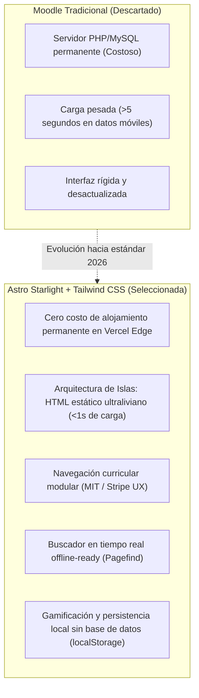
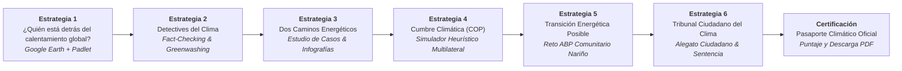
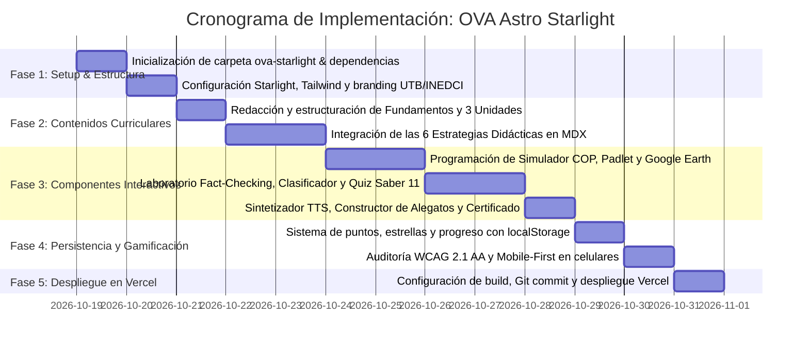

# Plan Maestro de Trabajo: Plataforma LMS Modular del OVA en Astro Starlight + Tailwind CSS
## Proyecto Integrado Tecno-Pedagógico — Maestría en Educación Mediada por las TIC (UTB)
### *"Clima, Poder y Futuro: Decisiones Globales, Responsabilidades y Transición Energética"*

---

> **Estado:** Propuesta Técnica y Pedagógica Aprobada para Ejecución  
> **Institución Universitaria:** Universidad Tecnológica de Bolívar (UTB) — Facultad de Educación  
> **Institución Educativa de Aplicación:** Institución Educativa Ciudad de Ipiales (INEDCI), Nariño, Colombia  
> **Población Objetivo:** Grado Undécimo (11-2) • Área: Ciencias Sociales y Competencias Ciudadanas  
> **Equipo de Autores (Grupo 3):** Libia Ester Meza Bertel • Rafael Martínez Rodríguez • David Antonio Lucero Figueroa  
> **Asesoría Docente UTB:** Mg. Liliana Castaño Lotero / Dr. Gabriel Román Meléndez  
> **Calificación Previa:** 5.00 / 5.00 en todas las actividades evaluativas  

---

## 1. Justificación y Selección Tecnológica: ¿Por qué Astro Starlight?

La selección de la **Opción 1: Plataforma LMS Modular con Astro Starlight + Tailwind CSS** responde con exactitud a las condiciones territoriales y pedagógicas de la **I.E. Ciudad de Ipiales** y a las exigencias académicas de la **Universidad Tecnológica de Bolívar (2026)**:



### Principales Ventajas Técnicas y Pedagógicas:
1. **Rendimiento Máximo en Conectividad Escolar:** Las instituciones educativas de Nariño presentan variabilidad en el ancho de banda. Astro entrega **0 KB de JavaScript innecesario** en las páginas de lectura y solo hidrata los componentes interactivos (Simulador COP, Quizzes, Generador de Certificado).
2. **Navegación Curricular Clara:** Estructura jerárquica con menú lateral organizado por las 3 Unidades UTB y las 6 Estrategias Didácticas, barra de lectura superior y tabla de contenido interna por página.
3. **Persistencia sin Fricción:** El estudiante no requiere registrar usuario ni contraseña; su progreso, estrellas acumuladas y checkmarks de actividades completadas se almacenan de forma segura en su navegador mediante `localStorage`.
4. **Despliegue Continuo Automatizado (CI/CD):** Vinculado al repositorio Git y desplegado globalmente en Vercel con certificado SSL automático y CDN Edge de baja latencia.

---

## 2. Alineación Curricular y Recursos Oficiales

### 2.1. Marco Curricular del Ministerio de Educación Nacional (MEN)
* **Área:** Ciencias Sociales y Competencias Ciudadanas (Grado 11.°).
* **Derecho Básico de Aprendizaje (DBA - Tercer Periodo):**
  > *"Analizar críticamente la relación entre las decisiones económicas, políticas y sociales de los diferentes actores involucrados en el cambio climático y sus efectos sobre el bienestar y la supervivencia de la humanidad, mediante el uso de herramientas digitales que permitan investigar, interpretar información, contrastar perspectivas, argumentar y proponer alternativas de transición energética sostenible."*
* **Enfoque Pedagógico:** Aprendizaje Basado en Problemas (ABP), pensamiento crítico socioespacial y diseño universal para el aprendizaje (DUA).

### 2.2. Las 3 Unidades del Currículo de Maestría UTB
1. **Unidad 1: Fundamentos tecno-pedagógicos en el aula:** Tríada TIC-TAC-TEP, tendencias, desafíos socioambientales y buenas prácticas.
2. **Unidad 2: Selección y evaluación de herramientas digitales:** Matriz de caracterización multicriterio (accesibilidad, usabilidad, pertinencia y valor formativo).
3. **Unidad 3: Diseño y evaluación de experiencias de aprendizaje:** Prototipado interactivo, aplicación en aula y evaluación del impacto tecno-pedagógico (Modelo TAM/SUS).

### 2.3. Enlaces y Recursos que se Integran Directamente en el OVA
* **Padlet de Investigación Oficial:**  
  [¿Quién está detrás del calentamiento global? - Expedientes de investigación Grado 11](https://padlet.com/davidlucerofigueroa/quien-esta-detras-del-calentamiento-global-expedientes-de-in-s024eu86qk7ytea2ek7s) (Prof. David Lucero).
* **Proyecto Cartográfico en Google Earth:**  
  [Localización Territorial de Actores y Emisiones](https://earth.google.com/earth/d/1kKvMXt5ClWOBMWS40fiURhtmqWodyjDH?usp=sharing).
* **OVA Previo en Producción:**  
  [https://ova-cambio-climatico.vercel.app/](https://ova-cambio-climatico.vercel.app/) (del cual se migran y potencian todos los contenidos y simulaciones).
* **Dossier de Casos Reales & Guías de Trabajo:** Archivos de estudio de caso de transición energética, matrices de análisis de fuentes y rúbricas analíticas oficiales.

---

## 3. Arquitectura de Contenidos: Mapeo de las 6 Estrategias Didácticas

La plataforma organizará el recorrido formativo del estudiante en **6 grandes estrategias didácticas articuladas**:



| N.° | Estrategia Didáctica | Enfoque Pedagógico | Herramientas Integradas | Producto de Aprendizaje |
| :---: | :--- | :--- | :--- | :--- |
| **1** | **¿Quién está detrás del calentamiento global?** | Investigación socioespacial y justicia climática histórica (deuda ecológica). | **Google Earth** (proyecto territorial) + **Padlet** (muro de expedientes colaborativos). | Ficha digital de investigación de actores y mapa de responsabilidades. |
| **2** | **Detectives del clima** | Alfabetización informacional, curaduría crítica y combate al *greenwashing*. | **Laboratorio de Fact-Checking** (3 expedientes documentales verídicos del IPCC). | Matriz "Detective Climático" (Fuente, Evidencia, Argumento, Interés, Confiabilidad). |
| **3** | **Dos caminos para el futuro energético** | Estudio de casos comparativos sobre transición energética y desarrollo (PIB vs Emisiones). | Guía metodológica de caso + visualizador interactivo tipo **Canva**. | Infografía interactiva "Dos países, dos estrategias frente a la transición". |
| **4** | **La Cumbre Climática (COP)** | Aprendizaje experiencial mediante simulación de negociación multilateral y acuerdos vinculantes. | **Simulador Interactivo COP** (termostato global °C vs índice de equidad social %). | Resolución oficial de compromisos multilaterales y balance de líneas rojas. |
| **5** | **Diseñemos una transición energética posible** | Aprendizaje Basado en Problemas (ABP) territorializado en comunidades de Nariño/Colombia. | Módulo interactivo **Genially / ABP** con matriz de viabilidad en 4 dimensiones. | Prototipo del "Plan Comunitario de Transición Energética 2035". |
| **6** | **Tribunal Ciudadano del Clima** | Deliberación ciudadana, argumentación estructurada y defensa de derechos colectivos. | **Constructor de Alegatos** (Tesis, 3 argumentos, evidencias, contraargumento y petitorio). | Alegato individual fundamentado y sentencia colegiada del Tribunal. |

---

## 4. Estructura de Carpetas del Proyecto

Para mantener el orden y la seguridad absoluta del repositorio, crearemos la plataforma Astro en esta subcarpeta dedicada `ova-starlight/`. De esta forma:
1. El OVA actual (`index.html`, `app.js`, `presentacion.html`) sigue funcionando y publicado sin interrupciones.
2. La nueva plataforma se construye con herramientas modernas y se conecta de forma limpia a Vercel.

```text
ova-cambio-climatico/
├── archivos ova/                         # Documentación curricular original y guías UTB
├── index.html, app.js, styles.css        # OVA clásico HTML5 (preservado como backup)
├── presentacion.html                     # Presentación interactiva UTB
├── INFORME_PROYECTO_INTEGRADO_TIC.md     # Memoria técnica completa de la maestría
└── ova-starlight/                        # NUEVA PLATAFORMA LMS MODULAR (Astro + Starlight + Tailwind)
    ├── PLAN_DE_TRABAJO.md                # Este documento de planificación técnica y pedagógica
    ├── package.json                      # Configuración de dependencias (Astro, Starlight, Tailwind)
    ├── astro.config.mjs                  # Configuración de rutas, temas, búsqueda y plugins
    ├── tailwind.config.cjs               # Configuración de estilos y paleta institucional
    ├── public/                           # Logos UTB, INEDCI, audios, favicon e infografías
    └── src/
        ├── assets/                       # Gráficos vectoriales, diagramas y evidencias
        ├── components/                   # ISLAS INTERACTIVAS ASTRO / REACT / VANILLA
        │   ├── CopSimulator.astro        # Simulador dinámico COP (°C vs Equidad %)
        │   ├── FactCheckingLab.astro     # Laboratorio de noticias y greenwashing
        │   ├── PadletEmbed.astro         # Integración responsiva del muro Padlet de clase
        │   ├── EarthViewer.astro         # Integración del visor cartográfico Google Earth
        │   ├── MeasureClassifier.astro   # Clasificador interactivo de medidas climáticas
        │   ├── SaberQuiz.astro           # Motor evaluativo tipo Saber 11 con retroalimentación
        │   ├── CitizenTribunal.astro     # Constructor guiado de alegatos con exportación
        │   ├── ProgressBar.astro         # Barra global de progreso con localStorage
        │   ├── SpeechNarrator.astro      # Sintetizador de voz Web Speech API (DUA / Accesibilidad)
        │   └── CertificateModal.astro    # Generador de Diploma y Pasaporte Climático en PDF
        └── content/
            └── docs/                     # CONTENIDOS CURRICULARES EN MDX ESTRUCTURADO
                ├── index.mdx             # Portada LMS interactiva, bienvenida y objetivos
                ├── fundamentos/
                │   ├── 01-contexto-dba.mdx     # Contexto INEDCI, DBA 11.° y marco UTB
                │   ├── 02-unidades-utb.mdx     # Las 3 Unidades curriculares de la maestría
                │   └── 03-rubrica-formativa.mdx # Rúbrica analítica y criterios de evaluación
                ├── estrategias/
                │   ├── estrategia-1-quien-esta-detras.mdx   # Google Earth + Padlet
                │   ├── estrategia-2-detectives-clima.mdx    # Laboratorio de Fact-Checking
                │   ├── estrategia-3-dos-caminos.mdx         # Estudio de casos comparativos
                │   ├── estrategia-4-cumbre-cop.mdx          # Simulador Multilateral COP
                │   ├── estrategia-5-transicion-posible.mdx  # Reto ABP Comunitario
                │   └── estrategia-6-tribunal-ciudadano.mdx  # Juicio y alegato argumentativo
                ├── evaluacion/
                │   ├── prueba-saber-11.mdx       # Test interactivo tipo ICFES
                │   ├── prueba-piloto-resultados.mdx # Evidencias escala TAM/SUS y grupo focal
                │   └── pasaporte-climatico.mdx   # Certificado oficial de grado 11.°
                └── recursos/
                    ├── guia-docente.mdx          # Guía metodológica para el facilitador
                    ├── dossier-documental.mdx    # Expedientes de fuentes y bibliografía APA 7
                    └── presentacion-proyecto.mdx # Visor de la presentación interactiva UTB
```

---

## 5. Fases y Cronograma de Ejecución



### Detalle de Entregables por Fase:
* **Fase 1 (Entorno y Configuración Base):**
  * Creación del proyecto Astro Starlight en `ova-starlight/`.
  * Integración con Tailwind CSS, soporte para iconos educativos, paleta institucional (Navy `#0f172a`, Teal `#0d9488`, Forest `#15803d`, Amber `#d97706`).
  * Barra de navegación y buscador multilingüe instantáneo (Pagefind).

* **Fase 2 (Contenidos Didácticos y Curriculares):**
  * Migración enriquecida de los textos del OVA anterior y los documentos evaluativos calificados con 5.0.
  * Formulación de las consignas didácticas de las 6 estrategias con preguntas orientadoras y matrices.
  * Integración de las 3 unidades temáticas de la maestría UTB.

* **Fase 3 (Islas Interactivas y Multimodales):**
  * **Simulador COP reactivo:** Deslizadores de política (Reducción de Carbón, Fondo de Daños, Energías Renovables) con cálculo matemático en vivo de temperatura global y equidad distributiva.
  * **Integración Padlet & Earth:** Componentes con fallback elegante si el estudiante tiene conexión lenta, permitiendo abrir el Padlet embebido o mediante botón directo a la app.
  * **Laboratorio de Fact-Checking:** Módulo interactivo para emitir dictámenes (Verdadero, Falso, Greenwashing) con explicaciones pedagógicas sustentadas en el informe IPCC AR6.
  * **Sintetizador de Voz Web Speech API:** Narrador auditivo accesible en cada lección con cadencia docente.
  * **Constructor de Alegatos:** Formulario dinámico guiado para estructurar tesis y argumentos con copia rápida al portapapeles.

* **Fase 4 (Gamificación y Certificación):**
  * Almacenamiento local del avance (`localStorage`): checkmarks automáticos conforme el alumno lee o completa actividades.
  * Generador de **Pasaporte Climático Oficial** con firma digital de los autores (Libia Meza, Rafael Martínez, David Lucero) y descarga en PDF.

* **Fase 5 (Despliegue y Validación):**
  * Verificación de build limpio `npm run build`.
  * Configuración de Vercel (monorepo o subdirectorio `ova-starlight`).
  * Sincronización con el repositorio GitHub y entrega del enlace público en vivo.
