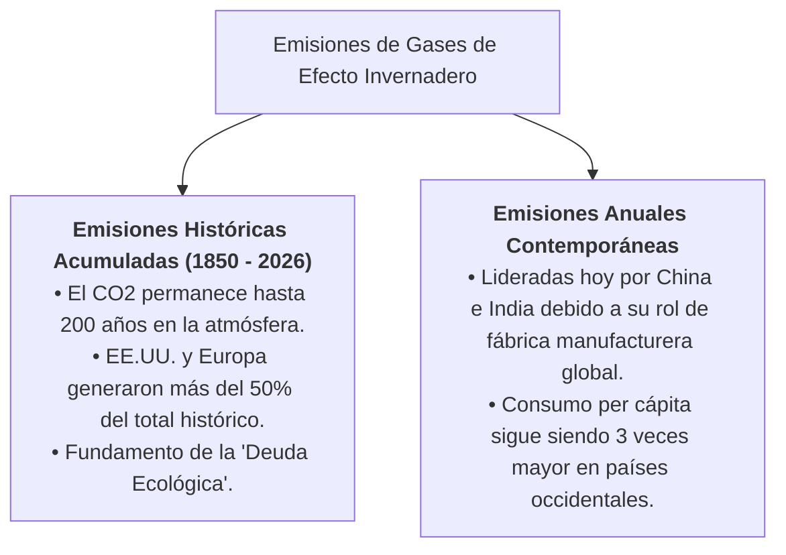

import SpeechNarrator from '../../../components/SpeechNarrator.astro';
import PadletEmbed from '../../../components/PadletEmbed.astro';

<SpeechNarrator title="la Estrategia 1: ¿Quién está detrás del calentamiento global?" />

## 1. Pregunta Problematizadora y Desafío Inicial

> *"Si todos los seres humanos dependemos del mismo planeta para sobrevivir, ¿por qué algunos actores políticos y corporativos tienen una responsabilidad histórica inmensamente mayor que otros frente a la crisis climática?"*

Frecuentemente, los discursos publicitarios intentan culpabilizar de manera homogénea a todos los ciudadanos con frases como *"la culpa es de todos por no reciclar"*. Sin embargo, el análisis desde las Ciencias Sociales exige estudiar **quiénes toman las decisiones macroeconómicas**, qué naciones impulsaron el modelo fósil desde el siglo XIX y qué corporaciones concentran el beneficio financiero de la extracción de hidrocarburos.

---

## 2. Emisiones Históricas Acumuladas vs. Emisiones Anuales Contemporáneas

Para entender la justicia climática, es indispensable diferenciar dos conceptos analíticos clave:

* **Deuda Ecológica del Norte Global:** Estados Unidos ha sido responsable de aproximadamente el **24% de todas las emisiones acumuladas de dióxido de carbono** desde 1850, seguido por los países de la Unión Europea (17%).
* **La Realidad de América Latina y Colombia:** Colombia representa **menos del 0.6% de las emisiones globales anuales**, pero es uno de los países más vulnerables a los desastres climáticos (inundaciones en La Mojana, sequías y derretimiento de glaciares andinos).

---

## 3. Actividad Interactiva en Vivo: Google Earth y Tablero Padlet

Sigue la ruta pedagógica diseñada para tu equipo:

1. **Exploración Cartográfica:** Abre el proyecto oficial en [Google Earth](https://earth.google.com/earth/d/1kKvMXt5ClWOBMWS40fiURhtmqWodyjDH?usp=sharing) y localiza la cuenca extractiva o la sede del actor que le correspondió a tu grupo.
2. **Construcción del Expediente:** Investiga sus decisiones políticas, matriz energética e impacto socioambiental.
3. **Publicación y Contraste:** Añade tu ficha digital en la columna correspondiente del tablero colaborativo de Padlet que encuentras a continuación:

<PadletEmbed />

---

## 4. Criterio de Autoevaluación de la Ficha Digital
Verifica que el expediente publicado por tu equipo en el Padlet contenga:
* [x] Identificación clara del actor (Estado, Empresa multinacional, u Organización civil).
* [x] Mínimo dos fuentes documentales verificables (IPCC, Climate Watch o agencias oficiales).
* [x] Distinción rigurosa entre hechos empíricos y opiniones o discursos corporativos.
* [x] Conexión explícita con el territorio y la protección del bienestar humano.
