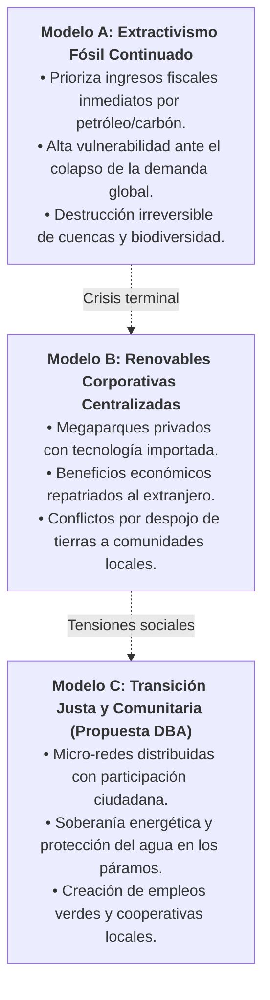

import SpeechNarrator from '../../../components/SpeechNarrator.astro';

<SpeechNarrator title="la Estrategia 3: Dos Caminos para el Futuro Energético" />

## 1. Pregunta Problema Central

> *"¿Es posible que un país reduzca sustancialmente sus emisiones de gases de efecto invernadero sin frenar su desarrollo socioeconómico ni condenar a su población a la pobreza energética?"*

El dilema de la transición energética no se reduce a un debate puramente tecnológico (paneles solares vs. pozos petroleros), sino que constituye una **disputa geopolítica y distributiva**. Si un país dependiente de las regalías petroleras o de la minería de carbón cierra intempestivamente sus yacimientos sin un plan de reconversión laboral, el impacto fiscal puede destruir el sistema de salud y educación pública. Por el contrario, si pospone la transición, los costos de reconstrucción por desastres climáticos arruinarán su economía a mediano plazo.

---

## 2. Comparación de Modelos de Transición: Tres Rutas en Disputa

---

## 3. Guía de Investigación de Estudio de Caso

Cada equipo de estudiantes debe seleccionar y comparar dos países con realidades contrastantes:

### Grupo de Países para Comparar (Sugeridos):
* **Caso 1 (País Industrializado del Norte Global):** Alemania (*Energiewende* con salida nuclear y carbón) o Dinamarca (líder en energía eólica comunitaria).
* **Caso 2 (País del Sur Global o Latinoamericano):** Colombia (dependencia fiscal de carbón/petróleo vs. potencial solar en La Guajira y geotérmico en Nariño) o Costa Rica (matriz 99% renovable).

### Dimensiones a Tabular en la Infografía Comparativa:
1. **Matriz Energética Inicial:** ¿Qué porcentaje depende de hidrocarburos frente a fuentes renovables?
2. **Decisiones Políticas e Inversión Pública:** ¿Qué incentivos tributarios y subsidios se crearon?
3. **Equilibrio Económico y Empleo:** ¿Qué ocurrió con los trabajadores de los sectores tradicionales?
4. **Barreras y Dificultades:** ¿Qué dependencia tecnológica o endeudamiento externo se generó?
5. **Lecciones para Ipiales y Nariño:** ¿Qué estrategias comunitarias de generación solar o hidroeléctrica a pequeña escala son replicables en nuestro territorio?

---

## 4. Producto de Aprendizaje: Infografía en Canva
Los grupos elaboran colaborativamente en Canva para la Educación una infografía interactiva titulada:  
**«Dos Países, Dos Estrategias frente a la Transición Energética»**, la cual será socializada en el Tribunal Ciudadano.
