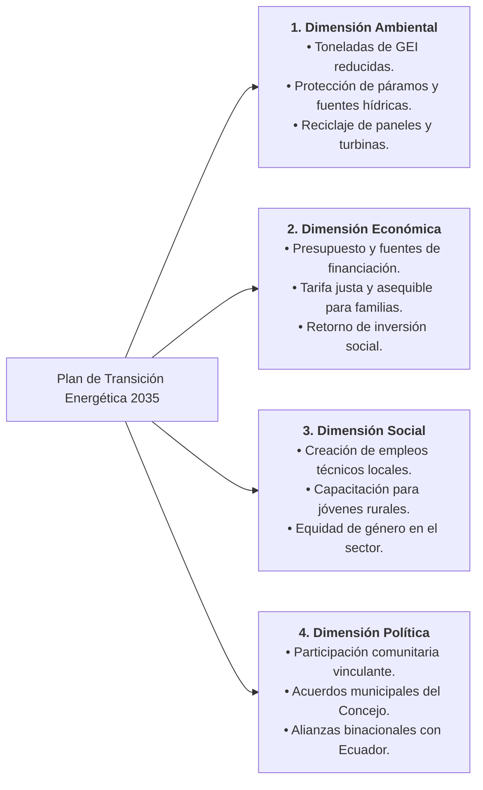

import SpeechNarrator from '../../../components/SpeechNarrator.astro';
import GamificationBar from '../../../components/GamificationBar.astro';
import MeasureClassifier from '../../../components/MeasureClassifier.astro';
import WordSearch from '../../../components/WordSearch.astro';

<GamificationBar />

<SpeechNarrator title="la Estrategia 5: Diseñemos una Transición Energética Posible" />

## 1. El Desafío ABP: Situación Territorial

> *"El municipio de Ipiales y los territorios del sur de Nariño enfrentan un doble desafío: por un lado, deben proteger sus ecosistemas de páramo y cuencas hídricas amenazadas por el cambio climático; por el otro, dependen de combustibles fósiles importados y de tarifas de energía eléctrica que golpean la economía familiar campesina y urbana. Tu equipo debe diseñar una estrategia de transición energética 2035 que sea ambientalmente sostenible, financieramente viable y socialmente justa."*

Para resolver este desafío, los estudiantes deben pasar de la crítica pasiva a la **creación de soluciones técnicas y normativas aplicables a su realidad**.

---

## 2. Dinámica Lúdica: Sopa de Letras Territorial

Antes de formular las propuestas comunitarias, afianza el vocabulario de soberanía ambiental encontrando los 6 conceptos clave en la siguiente sopa de letras interactiva:

<WordSearch />

---

## 3. Clasificación Formativa: Tipología de Medidas

Aprende a diferenciar qué medidas atacan la causa raíz del problema, cuáles gestionan riesgos inevitables y cuáles son meras tácticas de distracción corporativa:

<MeasureClassifier />

---

## 4. Matriz de Viabilidad del Plan Comunitario (4 Dimensiones)

El proyecto final de transición energética presentado por cada equipo en Genially o informe digital debe justificar rigurosamente cuatro dimensiones:

---

## 5. Oportunidades Energéticas Reales para Nariño e Ipiales
1. **Energía Solar Fotovoltaica en Altiplanos:** Excelente radiación en zonas abiertas del altiplano tuquerreño e ipialeño para techos solares en colegios, hospitales y viviendas rurales.
2. **Pequeñas Centrales Hidroeléctricas de Pasada (Filo de Agua):** Generación sin grandes embalses que no inundan tierras de cultivo ni alteran el caudal ecológico.
3. **Potencial Geotérmico:** Aprovechamiento del calor del subsuelo volcánico en la cordillera de Nariño (complejo volcánico Chiles - Cerro Negro).
4. **Biomasa Agrícola Residual:** Aprovechamiento de residuos de papa, cebolla y lácteos para biodigestores de gas doméstico en granjas campesinas.
