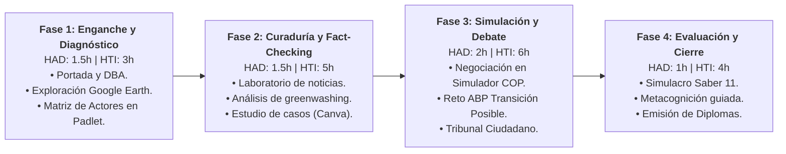

import SpeechNarrator from '../../../components/SpeechNarrator.astro';

<SpeechNarrator title="la Guía Metodológica para el Docente" />

## 1. Identificación Curricular y Carga Horaria

Esta guía orienta al cuerpo docente en la facilitación del Objeto Virtual de Aprendizaje (OVA) **«Clima, Poder y Futuro»** en el grado 11.°:

* **Horas con Acompañamiento Docente (HAD):** 6 horas distribuidas en 4 sesiones de aula (presenciales o sincrónicas).
* **Horas de Trabajo Independiente (HTI):** 18 horas para la investigación individual, recolección de evidencias y redacción de memoriales.
* **Modalidad:** Aprendizaje Colaborativo Basado en Problemas (ABP).

---

## 2. Secuencia Didáctica en Cuatro Fases

---

## 3. Preguntas Detonantes para la Facilitación
* **Para la Estrategia 1:** *"¿Por qué una persona en Ipiales que consume poca energía sufre las mismas sequías causadas por industrias al otro lado del océano?"*
* **Para la Estrategia 2:** *"¿Si una aerolínea te cobra 2 dólares extra por 'compensar tu vuelo', realmente se evitó que el avión quemara turbosina?"*
* **Para la Estrategia 4:** *"¿Estarías dispuesto a que suban los impuestos a la gasolina si ese dinero se usa para subsidiar paneles solares en familias campesinas?"*
* **Para la Estrategia 6:** *"¿Quién tiene más legitimidad moral y política para decidir el futuro energético de Nariño: el Ministerio de Minas en Bogotá o las comunidades que habitan el territorio?"*

---

## 4. Andamiaje y Diseño Universal para el Aprendizaje (DUA)
* **Estudiantes con Ritmos Rápidos:** Proponerles investigar acuerdos binacionales de interconexión eléctrica Colombia-Ecuador y formular enmiendas al tratado de la COP.
* **Estudiantes que Requieren Apoyo Adicional:** Fomentar el uso de la **lectura asistida por voz (Web Speech API)** y apoyarse en el botón de ejemplo modelo del Constructor de Alegatos.
